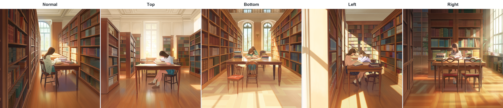
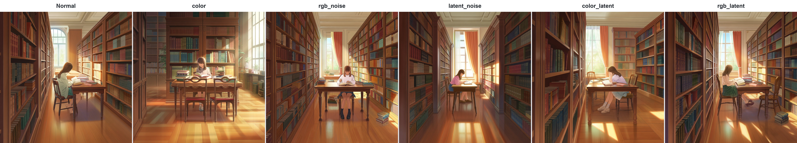
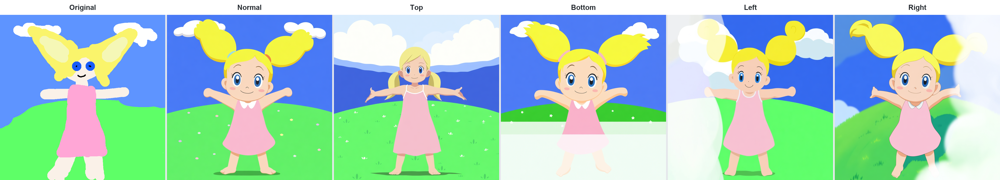
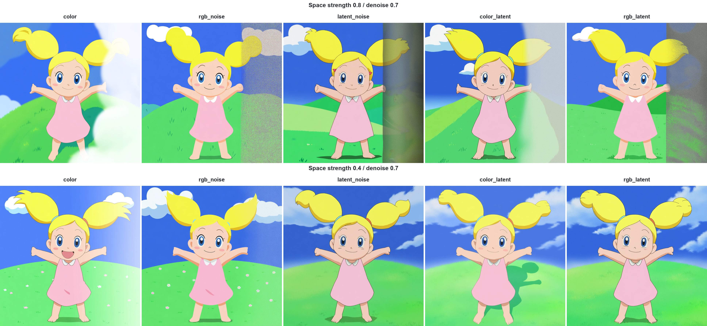

# Space Control Node

**Space Control** is a ComfyUI node for controlling open space in an image by adding a color or noise base to a selected region. Choose a solid color, RGB noise, latent noise, or a color/RGB base mixed with latent noise. No source image is required.

Select the top, bottom, left, right, a corner, the center, or all edges. Adjust the region width and base strength.

The examples use Anima, but Space Control is designed for use with a variety of compatible image-generation models.

**Space Control** は、指定範囲に色やノイズの下地を加え、絵の余白をコントロールするComfyUIノードです。単色・RGBノイズ・latentノイズ・色やRGBノイズとlatentノイズの混合から方式を選べます。元画像は不要です。

上下左右、四隅、中央、全周から範囲を選び、範囲の幅・下地の強度を調整できます。サンプルはAnimaを使用していますが、ほかのさまざまな画像生成モデルでも利用できる想定です。

詳細は英語の後に続きます。

## Sample results / サンプル

For the direction comparisons, T2I is shown left to right as **Normal → Top → Bottom → Left → Right**. I2I adds **Original** at the beginning. Normal uses Space strength `0`; the other four images use `color` mode with white (`#FFFFFF`). Each row uses the same prompt, seed, and sampling settings from its bundled workflow.

方向の比較は、T2Iが左から **ノーマル → 上 → 下 → 左 → 右**。I2Iは先頭に **Original（入力画像）** を加えています。ノーマルはSpace strength `0`、上下左右は`color`方式・白（`#FFFFFF`）です。各行は同梱ワークフローのプロンプト・seed・サンプリング設定を揃えて生成しています。

**T2I** — [workflow / ワークフロー](examples/space_control_t2i_anima.json)

**T2I — Space modes / 方式の比較**

Left to right / 左から: **Normal → color → rgb_noise → latent_noise → color_latent → rgb_latent**. All modes use position `right`, white (`#FFFFFF`), Width `0.35`, and Space strength `0.8` (Normal: `0`). The model, prompt, seed, CLIP, VAE, and sampling settings are identical to the T2I direction comparison above.

全方式で位置は右、色は白（`#FFFFFF`）、幅は`0.35`、下地強度は`0.8`（ノーマルは`0`）です。上のT2I方向比較とモデル・プロンプト・seed・CLIP・VAE・サンプリング設定を揃え、方式だけを変更しています。

**I2I** — [workflow / ワークフロー](examples/space_control_i2i_anima.json), input / 入力: [example.png](examples/example.png)

**I2I — Space mode × strength / 方式 × 下地強度の比較**

Top row: Space strength `0.8`; bottom row: `0.4`. Left to right: **color → rgb_noise → latent_noise → color_latent → rgb_latent**. Denoise is `0.7`, position is `right`, and the input image, prompt, seed, and other settings are the same throughout.

上段は下地強度`0.8`、下段は`0.4`。左から **color → rgb_noise → latent_noise → color_latent → rgb_latent**。denoiseは`0.7`、位置は右で、入力画像・プロンプト・seedなどを揃えています。

In I2I, modes other than `color` may be less effective at creating open space.

I2Iでは、`color`以外は効果を出しにくいかもしれません。

| Workflow | Size / サイズ | Denoise |
| --- | --- | --- |
| T2I | 1024 × 1024 | 1.0 |
| I2I | 768 × 768 | 0.7 |

Common / 共通: Anima Base V1.0, seed `1234`, `25` steps, CFG `5.5`, `euler_ancestral`, `beta`, Width `0.35`, Space strength `0.8` (Normal: `0`; two-axis comparison / 二軸比較: `0.8` and `0.4`). The comparison images retain the original resolution without cropping or scaling.

## Installation

1. Clone this repository, or download and extract its ZIP.
2. Place the complete extracted folder in `<ComfyUI>/custom_nodes/comfyui_space_control`. Its root `__init__.py` and inner `comfyui_space_control` folder must stay together.
3. Restart ComfyUI and refresh the browser.
4. Search for **Space Control** in the node menu; its category is `conditioning/space_control`.

The development environment has been tested with **ComfyUI 0.37.0 / Python 3.10.11**. Adding this node requires no extra Python packages, model downloads, or changes to ComfyUI's core files.

## Insert into an existing workflow

Place Space Control before **KSampler** or the equivalent sampling stage.

| Input | Connect from |
| --- | --- |
| `model` | The model branch used for sampling |
| `vae` | A VAE compatible with that model |
| `latent` | The latent you would normally send to the sampler |

Connect MODEL, VAE, and LATENT. Send positive and negative conditioning directly to the sampler.

| Output, in order | Connect to |
| --- | --- |
| MODEL | Sampler's `model` |
| LATENT | Sampler's `latent_image` |
| MASK | Optional downstream mask consumer |

Send the returned MODEL and LATENT to the **same sampling branch**.

## Quick start and examples

Start with `color` mode, position `right`, a white base, width `0.35`, strength `0.8`, and compare against normal generation.

- [Anima text-to-image with Space Control](examples/space_control_t2i_anima.json)
- [Anima image-to-image with Space Control](examples/space_control_i2i_anima.json)

Open the JSON in ComfyUI, or copy it to `<ComfyUI>/user/default/workflows`. The examples reference Anima model files and use a regular KSampler followed by VAE Decode.
For I2I, choose an input image in LoadImage. KSampler's default denoise is `0.7`. Choose Model, CLIP, VAE, and latent settings compatible with your installation.

**Seed** determines the random noise used to create the base in noise and mixed modes. Keeping it fixed makes the base reproducible, so you can compare changes to position, width, or strength. The `color` mode uses no random noise and ignores Seed. Using the same integer as KSampler is fine.

I2I defaults to ComfyUI's `example.png`. If it is missing from `<ComfyUI>/input`, copy the bundled [example.png](examples/example.png) there. You can choose a different image in LoadImage. The sample is copied unchanged from [ComfyUI/input/example.png](https://github.com/Comfy-Org/ComfyUI/blob/master/input/example.png); the upstream GPL-3.0 license is included in [example.LICENSE.txt](examples/example.LICENSE.txt).

See the [user guide](docs/space_control_guide.md) for controls, region geometry, errors, and implementation notes.

## Limitations

- Supports image latents.
- Space Control cannot share a sampling stage with spot corrections or inpainting that use a latent `noise_mask`, or with another model `denoise_mask_function`. For masked corrections, generate with Space Control first, then use the generated image and the original model in a separate sampling stage.
- The base does not detect or exclude objects. Open space is not guaranteed, and noise modes can increase detail or introduce objects. Results depend on the model, prompt, and sampler.

---

## 日本語

### インストール

1. このリポジトリをクローンするか、ZIPをダウンロードして展開します。
2. 展開したフォルダを丸ごと `<ComfyUI>/custom_nodes/comfyui_space_control` に配置します。直下の `__init__.py` と内部の `comfyui_space_control` フォルダを一緒に配置してください。
3. ComfyUIを再起動し、ブラウザーを更新します。
4. ノード検索で **Space Control** を検索します。カテゴリは `conditioning/space_control` です。

開発環境では **ComfyUI 0.37.0 / Python 3.10.11** で動作確認をしています。ノードを追加するために、Pythonパッケージの追加・モデルのダウンロード・ComfyUI本体の変更は必要ありません。

### 既存ワークフローへの挿入

**KSampler** または同等のサンプリング処理の前に配置します。

| 入力 | 接続元 |
| --- | --- |
| `model` | サンプリングに使うモデルの経路 |
| `vae` | モデルに対応するVAE |
| `latent` | 通常サンプラーへ渡しているlatent |

MODEL・VAE・LATENTの3入力を接続します。positiveとnegativeはサンプラーへ直接接続してください。

| 出力・順番 | 接続先 |
| --- | --- |
| MODEL | サンプラーの `model` |
| LATENT | サンプラーの `latent_image` |
| MASK | 必要に応じてマスクを扱うノード |

出力のMODELとLATENTは、**同じサンプリング経路**へ接続します。

### 最初の設定とワークフロー例

まずは `color` 方式・右・白・幅 `0.35`・下地強度 `0.8`で、通常生成と比較してください。

- [Anima T2I（テキストから生成）](examples/space_control_t2i_anima.json)
- [Anima I2I（画像から生成）](examples/space_control_i2i_anima.json)

JSONをComfyUIから開くか、`<ComfyUI>/user/default/workflows` にコピーします。例はAnimaのモデルファイルを指定しています。通常のKSamplerとVAE Decodeを使います。
I2IではLoadImageで入力画像を選んでください。KSamplerのdenoise初期値は`0.7`としています。使用環境に対応したModel・CLIP・VAE・latent設定を選んでください。

**Seed** は、ノイズ方式・混合方式で下地を作る乱数を決める値です。同じSeedなら同じ下地を再現できるため、位置・幅・強度を変えた結果を比較しやすくなります。`color` 単独では乱数を使わないため、Seedは結果に影響しません。KSamplerと同じ整数を使っても問題ありません。

I2Iの初期画像はComfyUIの`example.png`です。`<ComfyUI>/input` にない場合は、同梱の[example.png](examples/example.png)をコピーしてください。LoadImageで別の画像に変更することもできます。画像は[ComfyUI/input/example.png](https://github.com/Comfy-Org/ComfyUI/blob/master/input/example.png)から変更せず同梱しています。元リポジトリのGPL-3.0ライセンスは[example.LICENSE.txt](examples/example.LICENSE.txt)に収録しています。

設定項目・範囲の形状・エラー・内部処理の詳細は[操作ガイド](docs/space_control_guide.md#日本語)を参照してください。

### 制約

- 画像用latentに対応します。
- latentの`noise_mask`を使うスポット修正・インペイントや、モデルの別の`denoise_mask_function`とは、同じサンプリング工程で併用できません。マスクで修正する場合は、Space Controlで生成した画像と元のモデルを使い、別のサンプリング工程で行ってください。
- 物体を認識して除外する機能はありません。余白は保証されず、ノイズ方式では描き込みや物体が増えることもあります。結果はモデル・プロンプト・サンプラーに依存します。
