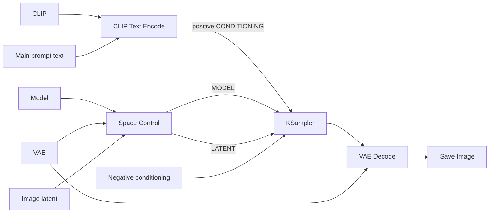
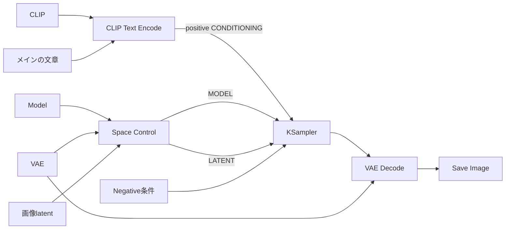

# Space Control User Guide

Space Control prepares a spatial base before sampling. It blends color or noise into a latent region and releases the region early in the sampling schedule. The node is intended to encourage open space.

For installation and example workflows, see the [README](../README.md).

## Connections

Connect `model`, `vae`, and `latent`. Positive and negative conditioning go directly to the sampler.

Use the returned MODEL and LATENT together on the same KSampler branch. Positive and negative conditioning connect directly to KSampler.

## Why Seed is needed

Seed determines the random noise used to create the base in noise and mixed modes. Fixing Seed reproduces the same base, making comparisons of position, width, and strength easier. The `color` mode ignores Seed because it uses no random noise.

Using the same integer as KSampler is fine. Space Control uses its own random generator and does not change KSampler's random state. The same seed does not mean that the base and sampling noise are identical.

## Controls

These defaults are defined by the node schema. Saved example workflows may choose a different position.

| Control / API name | Default | Accepted values and effect |
| --- | --- | --- |
| Position / `position` | `top` | One of the positions listed below |
| Width / `width_ratio` | `0.35` | `0.01–1.0`; normalized extent of the region, not a percentage of its area |
| Space strength / `strength` | `0.4` | `0–1.0`; blends the base and sets the initial restriction. Zero disables the base |
| Space mode / `space_mode` | `color` | `color`, `rgb_noise`, `latent_noise`, `color_latent`, or `rgb_latent` |
| Color / `color` | `#FFFFFF` | Opaque `#RRGGBB`; `#RRGGBBFF` is also accepted. Used in `color` and `color_latent` modes |
| Seed / `seed` | `0` | Integer `0–18446744073709551615`; affects noise modes only |

All node labels, help, and position options are English. Position values stored in workflow JSON are:

| Meaning | Stored value |
| --- | --- |
| Top / bottom / left / right | `top` / `bottom` / `left` / `right` |
| Top left / top right | `top_left` / `top_right` |
| Bottom left / bottom right | `bottom_left` / `bottom_right` |
| Center / all edges | `center` / `all_edges` |

### Region width and boundaries

A mask value of 1 means full application; 0 means no application. Boundaries are feathered rather than hard.

- For an edge, width `0.35` selects roughly 35% of the corresponding dimension, including the feathered boundary.
- A corner is the intersection of the two edge regions. It is not an L-shaped union.
- Center width `0.35` spans roughly 35% of both image dimensions around the center.
- All edges width `0.35` extends roughly 17.5% inward from each edge, because this mode measures width relative to half the corresponding dimension.

These proportions are approximate on a discrete latent grid. The preview is the most direct way to inspect the selected region.

### Space modes

| Mode | How the base is created |
| --- | --- |
| `color` | A solid RGB image is encoded with the VAE |
| `rgb_noise` | Uniform random RGB pixels are encoded with the VAE |
| `latent_noise` | Gaussian noise is generated in the model's sampling space, then converted to the output latent format |
| `color_latent` | Mixes the selected solid color's VAE latent with latent noise at equal weight |
| `rgb_latent` | Mixes random RGB pixels encoded with the VAE and latent noise at equal weight |

Color and RGB noise encode one image and broadcast the base across the batch. Latent noise generates values for the whole sampling-space tensor, including its batch dimension.

The same integer seed can be shared with the sampler, as in the examples. Noise modes and mixed modes use a local random generator and do not change PyTorch's global RNG state. Keep the shared seed fixed when comparing settings. Sharing a seed does not make the base and sampling noise identical. `color` ignores the base seed; `color_latent` uses both the selected color and base seed. `rgb_noise` and `rgb_latent` ignore the selected color. All control values are still validated in every mode.

## Region mask and inline preview

Output order is MODEL, LATENT, MASK.

- MASK has shape `[1, H, W]` at the output latent's spatial resolution.
- After execution, the region preview appears inside Space Control at latent resolution.
- White marks the selected region, black marks the outside, and gray shows the feathered boundary.

The preview needs no separate Preview Image node. Connect MASK when you need to reuse the region downstream. The latent's internal `noise_mask` uses a different value, `1 - strength * region_mask`.

## Release schedule

The initial base is blended with the latent according to the region mask and base strength. A model hook gradually opens the latent noise mask, giving the model freedom to redraw the region.

The release cutoff is the schedule index at 30% of the actual sampling step count, rounded up with a minimum index of one. The transition is smooth in sigma space. A schedule with at most one sampling step opens the mask immediately.

## Compatibility and troubleshooting

Supported latent layouts are `[B, C, H, W]` and `[B, C, 1, H, W]`. Inputs must have nonempty dimensions and finite values. Color and RGB noise require an image VAE whose spatial compression is a positive integer and whose encoded latent matches the model.

| Symptom | Check |
| --- | --- |
| Node missing or import error | Confirm the inner folder is installed, restart ComfyUI, and inspect its startup log. The extension requires `comfy_api.latest` and `io.Color` |
| Existing noise mask or denoise hook error | Masked spot corrections and Space Control cannot share a sampling stage. Generate with Space Control first, then correct the generated image in a separate stage using the original model |
| VAE/model shape mismatch | Check the model, VAE, and latent pairing; different architectures may need different latent layouts |
| Color or seed seems ignored | Color affects `color` and `color_latent`; Seed affects noise and mixed modes |
| Preview looks small | It is at latent resolution and shows the mask, not the decoded image |

Video latents are rejected. The mask/hook conflict check is only needed when the base is active. Results depend on the model, prompt, and sampler. Open space is not guaranteed; noise modes can increase detail or introduce objects.

---

## 日本語

インストールとワークフロー例は[README](../README.md#日本語)を参照してください。

### 接続

`model`・`vae`・`latent` の3入力を接続します。positiveとnegativeはサンプラーへ直接接続してください。

出力のMODELとLATENTを同じKSamplerへ接続します。positiveとnegativeはKSamplerへ直接接続してください。

### Seedが必要な理由

Seedは、ノイズ方式・混合方式で下地を作る乱数を決める値です。Seedを固定すると同じ下地を再現でき、位置・幅・強度を変えた結果を比較しやすくなります。`color`単独では乱数を使わないため、Seedは結果に影響しません。

KSamplerと同じ整数を使っても問題ありません。Space Controlは専用の乱数生成器を使い、KSamplerの乱数状態を変更しません。同じSeedでも、下地とサンプリングのノイズが同一になるとは限りません。

### 設定項目

以下はノード定義の初期値です。保存済みのサンプルワークフローでは位置が異なる場合があります。

| 項目 / API名 | 初期値 | 有効な値と作用 |
| --- | --- | --- |
| Position（位置） / `position` | `top` | 下表の位置から選択 |
| Width（幅） / `width_ratio` | `0.35` | `0.01–1.0`。範囲の広がりを決める値で、面積の割合ではありません |
| Space strength（下地の強度） / `strength` | `0.4` | `0–1.0`。下地の合成量と初期の制約を調整。0で下地を無効化 |
| Space mode（方式） / `space_mode` | `color` | `color`・`rgb_noise`・`latent_noise`・`color_latent`・`rgb_latent` |
| Color（色） / `color` | `#FFFFFF` | 不透明な `#RRGGBB`。`#RRGGBBFF` も使用可能。`color`・`color_latent` で使用 |
| Seed / `seed` | `0` | 整数 `0–18446744073709551615`。ノイズ方式のみで作用 |

ノードの表示名・ヘルプ・選択肢は英語です。ワークフローJSONに保存する位置の値は次のとおりです。

| 位置 | 保存値 |
| --- | --- |
| 上下左右 | `top`・`bottom`・`left`・`right` |
| 上側の隅 | `top_left`・`top_right` |
| 下側の隅 | `bottom_left`・`bottom_right` |
| 中央・全周 | `center`・`all_edges` |

#### 範囲の幅と境界

マスクの1は完全適用、0は適用なしです。境界はぼかされています。

- 辺の幅 `0.35` は、ぼかした境界を含めて対応する画像寸法のおよそ35%を選びます。
- 隅は、2つの辺の範囲が重なる領域です。L字形ではありません。
- 中央の幅 `0.35` は、中心から縦横それぞれおよそ35%の範囲を選びます。
- 全周の幅 `0.35` は、各辺から内側へおよそ17.5%の範囲を選びます。この方式は各寸法の半分を基準にしています。

latentの離散的な格子で計算するため、割合は目安です。選択範囲はプレビューで確認してください。

#### 下地の方式

| 方式 | 作成方法 |
| --- | --- |
| `color` | 単色のRGB画像をVAEで変換 |
| `rgb_noise` | 一様乱数のRGB画素をVAEで変換 |
| `latent_noise` | モデルのサンプリング空間で正規分布のノイズを生成し、出力latent形式へ変換 |
| `color_latent` | 選択色をVAEで変換した下地とlatentノイズを同じ重みで混合 |
| `rgb_latent` | ランダムRGBをVAEで変換した下地とlatentノイズを同じ重みで混合 |

単色とRGBノイズでは1枚の画像を変換し、バッチ全体に同じ下地を展開します。latentノイズでは、バッチ次元を含むサンプリング空間のテンソル全体にノイズを生成します。

サンプルのように、サンプラーと同じ整数seedを共有できます。ノイズと混合方式は専用の乱数生成器を使い、PyTorch全体の乱数状態を変えません。比較時は共有seedを固定してください。同じseedを渡しても、下地とサンプリングのノイズが同一になるとは限りません。`color` は下地seedを使わず、`color_latent` は選択色とseedを使います。`rgb_noise`・`rgb_latent` は選択色を使いません。どの方式でも各設定値の妥当性は検証します。

### 範囲マスクとノード内プレビュー

出力順はMODEL・LATENT・MASKです。

- MASKの形状は `[1, H, W]`。出力latentの空間解像度で作成します。
- 実行後、ノード内に範囲マスクのプレビューを表示します。
- 白は選択範囲、黒は範囲外、灰色は境界のぼかしです。

これらは適用範囲を表すもので、生成画像ではありません。プレビュー用の接続は不要です。MASKは必要に応じて接続してください。MASK出力は範囲マスクです。latent内部の `noise_mask` は別の値で、`1 - strength * region_mask` になります。

### 下地の解放

範囲マスクと下地強度に従って下地をlatentへ合成し、モデルに設定した処理でnoise maskを徐々に開きます。これによりモデルが範囲内を描き直せるようになります。

解放の終了位置は、実際のサンプリングステップ数の30%を切り上げたスケジュールの添字です。最小値は1で、その位置までsigmaに応じて滑らかに変化します。サンプリングが1ステップ以下の場合は直ちにマスクを開きます。

### 対応範囲とトラブルシューティング

対応するlatent形状は `[B, C, H, W]` と `[B, C, 1, H, W]` です。各次元が空でなく、値が有限である必要があります。単色とRGBノイズには、空間圧縮率が正の整数で、変換後のlatentがモデルに対応する画像用VAEが必要です。

| 症状 | 確認事項 |
| --- | --- |
| ノードが見つからない・importエラー | 内部フォルダの配置を確認し、ComfyUIを再起動して起動ログを確認。`comfy_api.latest` と `io.Color` が必要 |
| 既存のnoise mask・denoise hookのエラー | マスクを使うスポット修正とSpace Controlは同じサンプリング工程で併用できません。Space Controlで生成した画像と元のモデルを使い、別工程で修正してください |
| VAEとモデルの形状不一致 | Model・VAE・latentの組み合わせを確認。モデルによって必要なlatent形状が異なる |
| 色やseedが反映されない | 色は `color`・`color_latent`、Seedはノイズ方式・混合方式で作用 |
| プレビューが小さい | latent解像度の範囲マスクであり、デコード済み画像ではありません |

動画latentは受け付けません。既存マスク・hookとの競合は下地が有効な場合に検証します。結果はモデル・プロンプト・サンプラーに依存し、余白を保証しません。ノイズ方式では描き込みや物体が増えることもあります。
